# Comprehensive Azure Firewall Implementation

Comprehensive Azure Firewall deployment and configuration lab demonstrating secure network traffic routing, custom DNS configuration, DNAT rule collection setup for jump host access, and outbound network and application rule enforcement. The lab included virtual network setup, User-Defined Route (UDR) creation, and policy validation across workload virtual machines.

---

## 1. Architecture & Provisioned Resources

### Core Infrastructure Topology

| Resource Type | Resource Name | Specification / Purpose |
| :--- | :--- | :--- |
| **Azure Firewall** | `Firewall` | Managed network security service enforcing network & application traffic rules |
| **Firewall Policy** | `test_policy` | Centralized policy defining DNAT, Network, and Application rule collections |
| **Virtual Network** | `net1` | Main VNet containing workload, jump host, and firewall subnets |
| **Route Table** | `testroute` | User-Defined Route directing all outbound traffic (`0.0.0.0/0`) through Firewall IP |
| **Workload VM** | `Srv-Work` | Internal workload server operating within isolated `Workload-SN` subnet |
| **Jump Server VM** | `Srv-Jump` | Management host deployed in `Jump-SN` subnet for remote administration |
| **Public IP Address** | `firewall-ip` | Static public IP address assigned to Azure Firewall |
| **Public IP Address** | `Srv-Jump-ip` | Public IP for direct remote access to the Jump Server |

---

### Provisioned Environment Validation

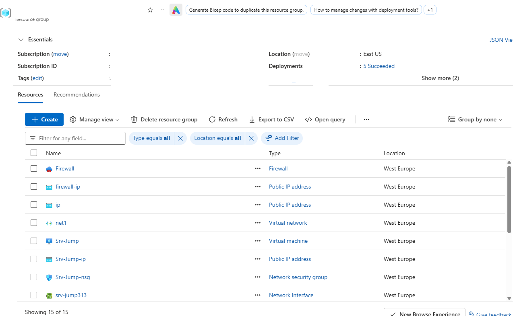

*First part of the resource group inventory confirming deployment of network interfaces, public IPs, and VM resources.*

---

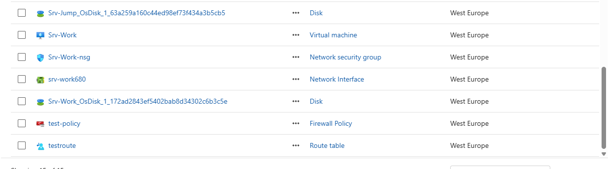

*Second part of the resource group inventory confirming deployment of virtual machines, disks, firewall policy, and route table.*

---

## 2. Azure Firewall & Network Implementation

### Step 1: Deploy Virtual Network and Virtual Machines

Provisioned Virtual Network `net1` with dedicated subnets for workload (`Workload-SN`), jump host (`Jump-SN`), and Azure Firewall (`AzureFirewallSubnet` and `AzureFirewallManagementSubnet`).

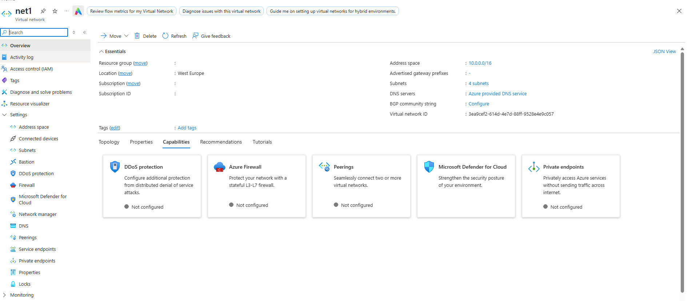

*Virtual network overview showing subnets and associated network capabilities.*

---

### Step 2: Configure Virtual Machines

Configured `Srv-Jump` as the management host and `Srv-Work` as the internal workload server without a public IP.

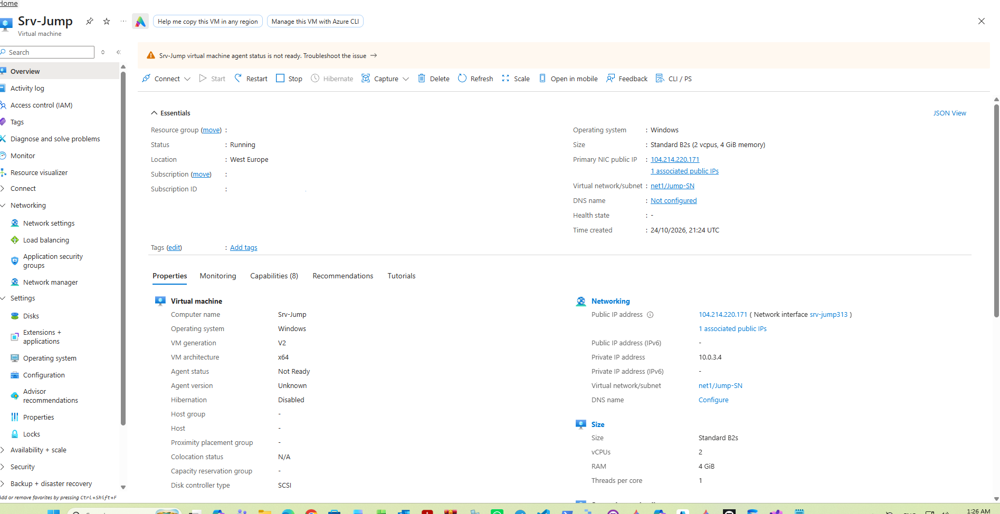

*Jump server virtual machine overview showing running status and assigned public IP.*

---

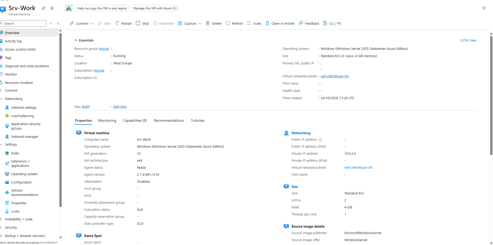

*Workload server virtual machine overview confirming private network configuration without a public IP.*

---

### Step 3: Deploy Azure Firewall Instance

Deployed an Azure Firewall instance with Basic SKU and attached the firewall policy `test-policy`.

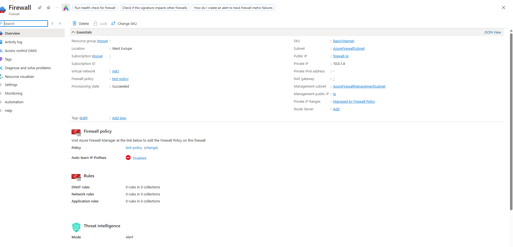

*Azure Firewall overview confirming active provisioning state and private IP assignment (`10.0.1.4`).*

---

### Step 4: Configure User-Defined Route (UDR)

Created route table `testroute` and configured a default route (`0.0.0.0/0`) targeting Azure Firewall's private IP (`10.0.1.4`) as the next hop, linked to `Workload-SN`.

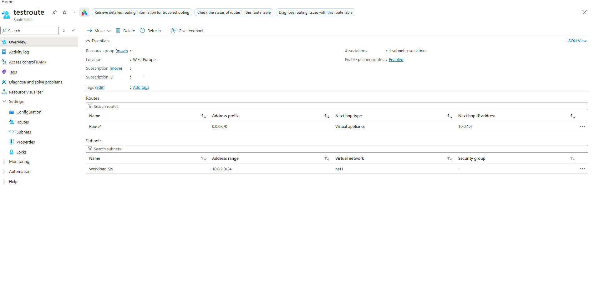

*User-Defined Route sending all workload outbound traffic through the Azure Firewall virtual appliance.*

---

### Step 5: Configure Workload Custom DNS Settings

Configured custom DNS server addresses directly on the workload server's network interface `srv-work680` to enable external name resolution through firewall filtering rules.

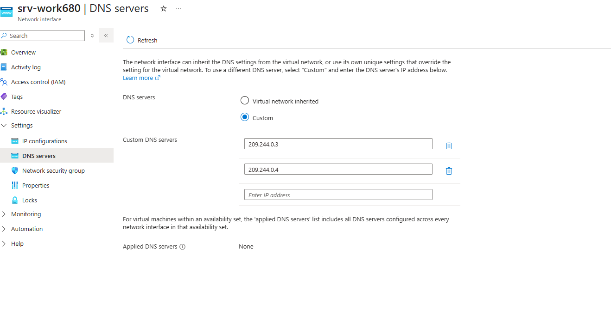

*Custom DNS server configuration applied to the network interface of the workload server.*

---

## 3. Firewall Policy & Rule Collections

### Step 1: Configure DNAT Rule Collection for Inbound RDP Access

Configured a Destination NAT (DNAT) rule (`rdp-nat`) on `test-policy` mapping incoming traffic on port `3389` of the firewall public IP (`52.157.81.124`) to the workload server (`10.0.2.4`).

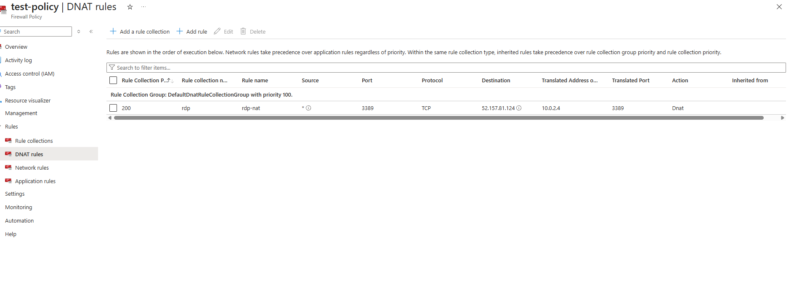

*DNAT rule mapping external RDP traffic directly to internal workload VM IP address.*

---

### Step 2: Configure Network Rule Collection for DNS Access

Added a Network rule (`Allow-DNS`) allowing UDP traffic on port `53` from the workload subnet (`10.0.2.0/24`) to external DNS servers (`209.244.0.3`, `209.244.0.4`).

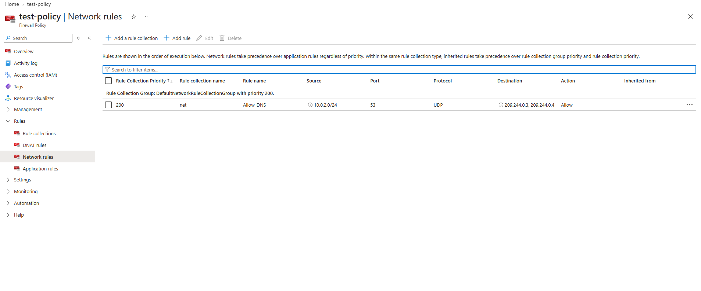

*Network rule allowing UDP port 53 traffic to pass from workload subnet to external DNS servers.*

---

### Step 3: Configure Application Rule Collection for Google Web Access

Added an Application rule (`Allow-Google`) permitting HTTP/HTTPS traffic from `10.0.2.0/24` specifically to target FQDN `www.google.com`.

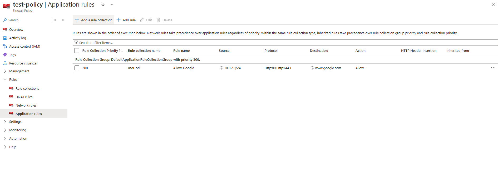

*Application rule permitting HTTP/HTTPS traffic exclusively to www.google.com.*

---

## 4. Verification & Validation

### Step 1: Connect to Workload Server via Jump Host

Established a Remote Desktop session to `Srv-Jump` to manage the isolated environment.

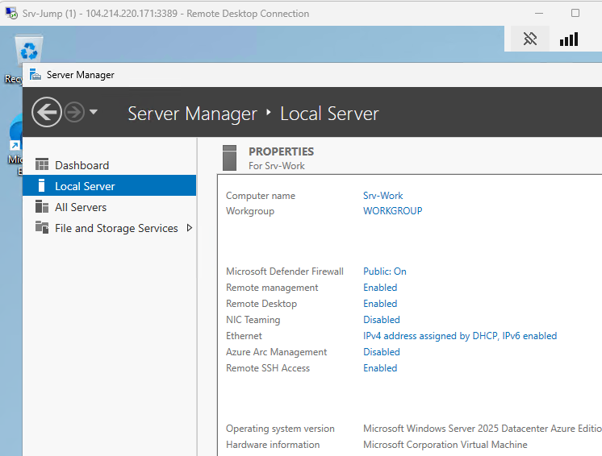

*Successful Remote Desktop connection established to the Srv-Jump management host.*

---

### Step 2: Configure Server Security Settings

Disabled Internet Explorer Enhanced Security Configuration on `Srv-Work` to facilitate outbound browser testing.

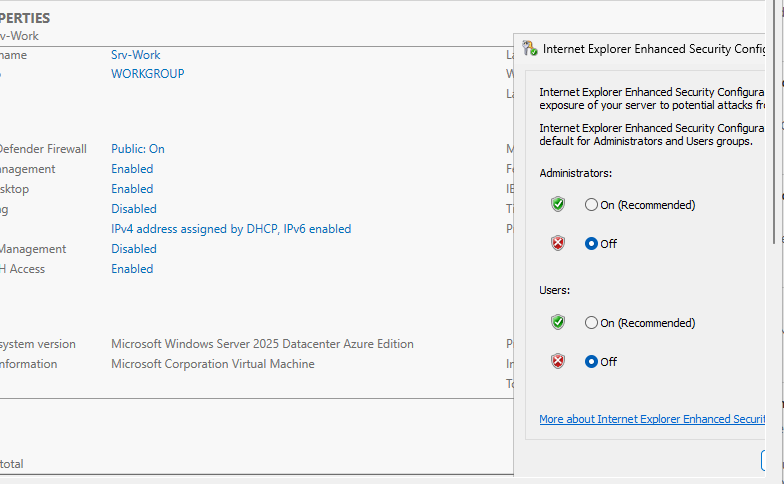

*Internet Explorer Enhanced Security Configuration disabled for administrative web browsing tests.*

---

### Step 3: Verify Allowed Outbound Web Traffic (Google)

Opened web browser on `Srv-Work` (`10.0.2.4`) and navigated to `https://www.google.com`, confirming successful connection allowed by Azure Firewall Application Rule.

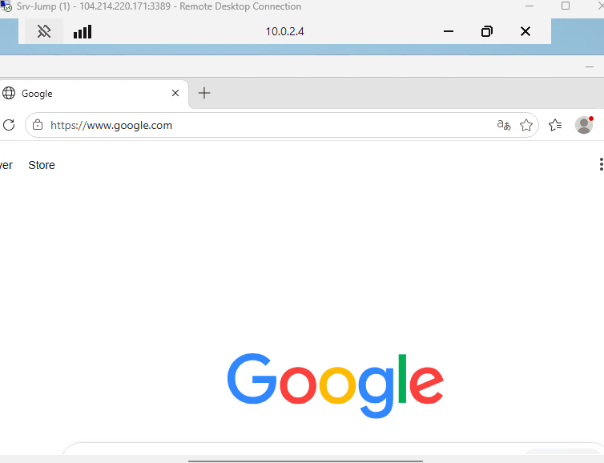

*Successful connection to www.google.com matching configured firewall application rule.*

---

### Step 4: Verify Denied Outbound Web Traffic (Microsoft)

Attempted navigation to `microsoft.com` from `Srv-Work`, confirming traffic rejection with default firewall deny rule action.

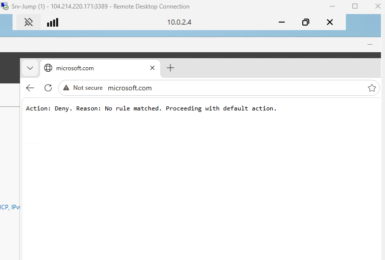

*Azure Firewall blocking non-matched outbound web traffic with default deny response.*
